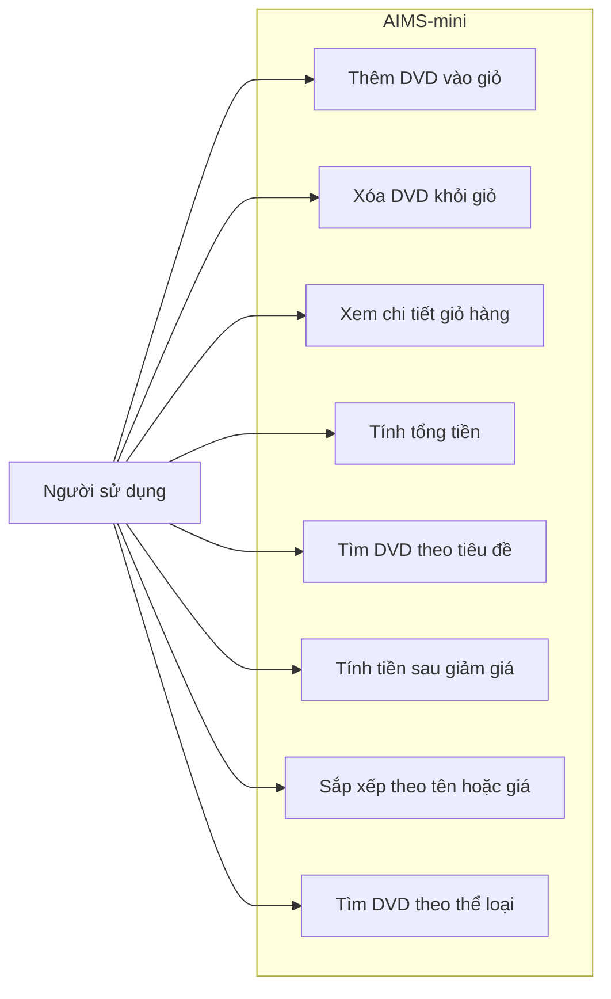

# Use case AIMS-mini

Tác nhân: người sử dụng thư viện AIMS-mini hoặc chương trình minh họa CLI. `main.py` minh họa thao tác giỏ hàng; các hàm tìm kiếm được gọi qua API Python.

## Yêu cầu hành vi

- Giỏ hàng chứa tối đa 20 DVD; thêm vượt giới hạn trả về `False`.
- Xóa thành công trả về `True`; DVD không có trong giỏ trả về `False`.
- Giỏ hàng trống hiển thị `The cart is empty`.
- Tổng tiền bằng tổng `cost` của các DVD; dữ liệu mẫu có tổng 63.89 $.
- Tìm kiếm theo một phần tiêu đề; yêu cầu không phân biệt hoa thường.
- Thay đổi yêu cầu hoặc báo lỗi được theo dõi bằng Issue và Pull Request.
- Phần trăm giảm giá thuộc [0, 100]; tổng sau giảm bằng tổng nhân (1 - phần trăm / 100).
- Sắp xếp giỏ tăng dần theo tiêu đề hoặc giá, không làm thay đổi tổng tiền.
- Tìm thể loại bằng so khớp tên thể loại, không phân biệt hoa thường.
